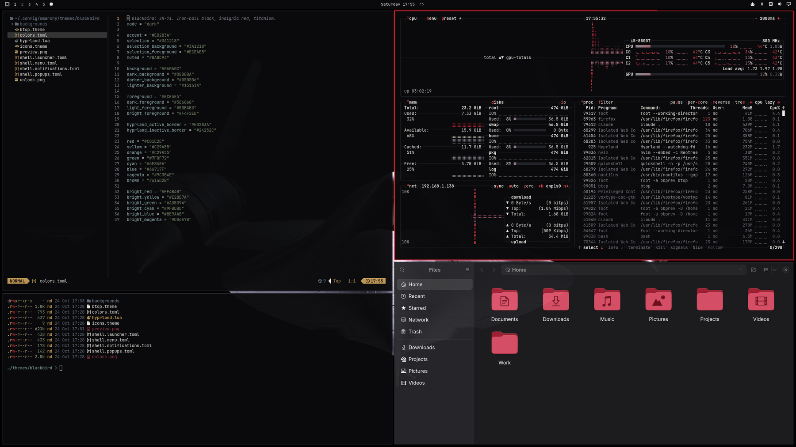

# Blackbird

An SR-71 Blackbird theme for [Omarchy](https://omarchy.org). Iron-ball black,
titanium grey, and one accent: the red of the SR-71's insignia.



## Install

```bash
omarchy theme install https://github.com/nikdelgado/omarchy-blackbird-theme
omarchy theme set blackbird
```

## Palette

| Role | Hex | Name |
|---|---|---|
| Background | `#0A0A0C` | Iron Ball |
| Surface | `#15161A` | Hull |
| Inactive borders, selected rows | `#24252C` | Chine |
| Secondary text | `#8A8C94` | Titanium |
| Foreground | `#ECEAE5` | Canopy |
| Accent | `#E0283A` | Insignia |
| Bright red | `#FF4B4B` | Afterburner |
| Selection | `#3A1218` | Oxide |

The ANSI colors are muted on purpose so red stays the only loud color.

## What's included

- `colors.toml`: the palette. Omarchy generates terminal, Neovim, VS Code,
  Chromium and other app configs from it.
- `hyprland.lua`: solid red active border and a soft red shadow.
- `btop.theme`: graphs run titanium → insignia → afterburner.
- `shell.*.toml`: notification, launcher, menu and popup surfaces.
- `icons.theme`: Yaru-red.
- `backgrounds/`: the SR-71 head-on on pure black, 5160×2160. Fits ultrawide
  screens and center-crops cleanly to 16:9.

## Credits

Wallpaper generated with Midjourney.
